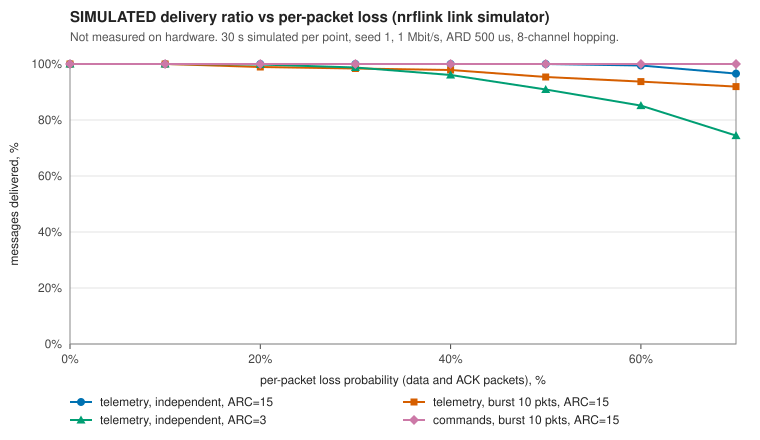

# nrf24-telemetry-link

[](https://github.com/projectbin07-stack/nrf24-telemetry-link/actions/workflows/ci.yml)
[](LICENSE)

A reliable, low-overhead telemetry and command link over nRF24L01+ radios
for robots and remote sensor nodes, with a C++17 protocol core that is unit
tested on the host and a link simulator that runs the same link logic.

> **Hardware validation status: nothing in this repository has been tested
> with real radios.** The firmware compiles in CI for six board
> environments and the core is tested against a register-level fake chip and
> a simulator. See [Hardware validation status](#hardware-validation-status).

## Why

Enhanced ShockBurst (ESB) on the nRF24L01+ already acknowledges and
retransmits packets, so it is tempting to send structs straight through
`write()`. That stops working as soon as you need any of these:

* messages longer than 32 bytes;
* commands that must arrive **exactly once**: ESB reports MAX_RT when only
  the ACK was lost, so a naive retry delivers the command twice, and an ACK
  payload is retired by the receiver as soon as the next packet arrives,
  even if the transmitter never got it (spec section 7.8.6);
* high-rate telemetry where the *newest* sample matters more than every sample;
* an end-to-end integrity check (the radio CRC covers one packet only);
* staying usable when a Wi-Fi network sits on your channel;
* numbers that tell you how good the link is, from a chip without RSSI.

This project adds a small link layer on top of ESB that does those things in
about 12 KB of flash and 0.8 KB of static RAM on an ATmega328P (node build), and a
host side to decode, log and simulate it.

## Features

**Core (`lib/linkcore`, C++17, no Arduino headers, 60 native unit tests)**

* nRF24L01+ driver written from the Nordic product specification over
  abstract `SpiBus` / `OutputPin` / `Clock` interfaces: channel, data rate
  (with read-back to detect non-plus clones), PA level, CRC, address width,
  pipes, dynamic payloads, ACK payloads, `W_TX_PAYLOAD_NOACK`,
  auto-retransmit delay/count, STATUS/IRQ handling, FIFO management,
  OBSERVE_TX and RPD. Tested against a register-level fake chip
  (`test/fakes/fake_nrf24.h`). Spec citations: [docs/radio.md](docs/radio.md).
* Link layer: 5-byte header, fragmentation and reassembly up to 160-byte
  messages (64 on the Nano build), CRC-16/CCITT-FALSE end to end, a
  stop-and-wait **reliable channel** (commands) with cumulative ack, timeout,
  bounded retries and duplicate suppression, and a **best-effort channel**
  (telemetry) with newest-wins replacement and loss counting from sequence gaps.
* Deterministic **channel hopping** from a shared seed, node-driven timing
  with guard times, and gateway park-and-scan resynchronisation that also
  escapes a jammed channel.
* **Link-quality metrics**: delivery ratio over the last 32 transmissions,
  mean ARC_CNT, an RPD-based signal proxy and a 0-100 score.
* A compact versioned **message schema**: battery (the INA219 project's
  fields), wheel odometry, IMU sample, generic key/value, commands.
* Gateway **USB serial framing**: COBS + CRC-16, the same packet layout as the
  encoder-odometry-firmware protocol that serial-scope decodes.

**Firmware (`src/`, Arduino framework)**: a node (telemetry out, commands in)
and a gateway (USB serial bridge) for Arduino Nano, ESP32 DevKit and
NUCLEO-F401RE.

**Host (`host/`, Python >= 3.10, stdlib + pyserial)**: `nrflink` CLI to
monitor and log gateway output, send commands, and run the **link
simulator**: a pure-Python model of two radios (ESB timing, PID duplicate
filter, ACK-payload FIFO semantics, Bernoulli or Gilbert-Elliott burst loss,
Wi-Fi interference) running a line-by-line port of the C++ link layer.

**Shared test vectors** (`test/vectors/link_vectors.json`): byte-exact
messages, serial frames, hop sequences and four scripted two-endpoint link
scenarios (including a 200-step random lossy exchange) that both the C++ and
the Python implementations must reproduce frame for frame. This is what
keeps the simulator honest about the firmware's behaviour.

## Supported hardware

| Board | Env (node / gateway) | Notes |
|---|---|---|
| Arduino Nano (ATmega328P, 16 MHz, 5 V) | `nanoatmega328` / `nanoatmega328_gateway` | messages capped at 64 bytes, serial body at 72 bytes (`LINKCORE_MAX_MESSAGE`, `LINKCORE_SERIAL_MAX_BODY`) to fit 2 KB RAM |
| ESP32 DevKit (ESP32-WROOM-32) | `esp32dev` / `esp32dev_gateway` | |
| ST NUCLEO-F401RE | `nucleo_f401re` / `nucleo_f401re_gateway` | STM32duino core |

Any nRF24L01+ module (PCB antenna or PA/LNA). A typical setup is the node on
a Nano in the robot and the gateway on an ESP32 or a second Nano at the PC.

## Wiring

**Power the module from 3.3 V, never 5 V** (VDD is 1.9-3.6 V). Solder a
**10 uF (or larger) capacitor plus 100 nF ceramic across VCC and GND right at
the module**: brown-outs during transmit bursts are the usual reason these
modules "send a few packets and stop". The Nano's 3V3 pin is too weak for
PA/LNA modules; use a separate 3.3 V regulator (for example an AMS1117-3.3
from 5 V) with its own capacitors. The module's inputs are 5 V tolerant, so
the Nano's 5 V SPI lines can connect directly.

| nRF24L01+ pin | Arduino Nano | ESP32 DevKit | NUCLEO-F401RE |
|---|---|---|---|
| 1 GND | GND | GND | GND |
| 2 VCC (3.3 V) | separate 3.3 V regulator (3V3 pin only for low-power modules) | 3V3 | 3V3 |
| 3 CE | D9 | GPIO4 | D9 (PC7) |
| 4 CSN | D10 | GPIO5 | D10 (PB6) |
| 5 SCK | D13 | GPIO18 | D13 (PA5) |
| 6 MOSI | D11 | GPIO23 | D11 (PA7) |
| 7 MISO | D12 | GPIO19 | D12 (PA6) |
| 8 IRQ (optional, not used) | D2 | GPIO27 | D2 (PA10) |
| battery divider (node, optional) | A0 | GPIO34 | A0 (PA0) |
| status LED (node) | none: D13 is SCK | GPIO2 | none: LD2 is on SCK |

All pins are `#define`s in [include/board_config.h](include/board_config.h)
and can be overridden with `-D` flags. The battery input expects a 2:1
divider by default (`NTL_VBAT_DIVIDER_X100=200`), giving up to 10 V on the
Nano and about 6.6 V on the 3.3 V boards; the ESP32 ADC is non-linear, so
treat its reading as approximate.

## Build and flash

Requires [PlatformIO](https://platformio.org/) (`pip install platformio`).

```sh
pio run -e nanoatmega328 -t upload            # node on a Nano
pio run -e esp32dev_gateway -t upload         # gateway on an ESP32
pio test -e native                            # host unit tests, no hardware
```

Both ends must use the same radio settings (`NTL_DATA_RATE`, `NTL_HOP_SEED`,
`NTL_HOP_*`, address in `board_config.h`). The node prints a human-readable
status line once a second on its USB serial port (115200 baud); the gateway
port carries only binary frames, read it with `nrflink monitor`.

Build flags you may want:

| Flag | Default | Meaning |
|---|---|---|
| `NTL_DATA_RATE` | 1 | 0 = 250 kbps (then set `NTL_ARD_CODE=5`), 1 = 1 Mbps, 2 = 2 Mbps |
| `NTL_PA_LEVEL` | 2 | 0..3 = -18, -12, -6, 0 dBm |
| `NTL_HOPPING` | 1 | 0 = stay on `NTL_FIXED_CHANNEL` (76) |
| `NTL_HOP_SEED` / `_FIRST` / `_LAST` / `_SPACING` / `_COUNT` / `_DWELL_MS` | 0x4E524634 / 2 / 80 / 2 / 8 / 50 | hop sequence and timing |
| `NTL_TELEMETRY_PERIOD_MS` | 50 | telemetry period (also settable by command) |
| `NTL_POLL_INTERVAL_MS` | 10 | idle poll period; bounds command latency |
| `NTL_DEMO_SENSORS` | 1 | synthetic odometry / IMU samples (see below); 0 sends only battery and status |
| `LINKCORE_MAX_MESSAGE` | 160 (64 on Nano) | largest application message |

**About the demo sensors.** The node firmware has no sensor drivers. With
`NTL_DEMO_SENSORS=1` it sends *synthetic* odometry and IMU samples (a robot
driving a 0.4 m circle) so the link can be exercised end to end; they are
not measurements. The battery voltage is a real ADC reading through the
divider, with the "no current sensor" flag set and state of charge "unknown".
To send real data, replace `build_demo_odometry()` / `build_demo_imu()` in
`src/node_main.cpp` with your sensor code; the encoders in
`linkcore/messages.h` take plain structs.

## Quick start (host)

```sh
cd host
pip install -e ".[dev]"
nrflink monitor --port COM5                   # or /dev/ttyUSB0; --csv log.csv to log
nrflink send --port COM5 period 100           # set the node's telemetry period
nrflink send --port COM5 status               # ask for a link status message
nrflink simulate --loss 0.3 --burst 5 --wifi 6
```

`nrflink monitor` prints one line per gateway packet. This is the decoder's
real output on the synthetic capture built in `host/tests/test_cli.py`
(`nrflink decode capture.bin`), which deliberately includes bad frames; it is
not a recording from hardware:

```
[  0] log: gateway ready
[  1] tel pipe1 rpd battery 7.400 V 0.0 mA 0.0 mW soc=? flags=0x80
[  2] tel pipe1 kv q=97
[  3] tel pipe1 undecodable message (unsupported schema version 2): 0201
[  4] stats up=5.0s rx=100 tel=0 lost=0 dup=0 crc=0 bad=0 cmd=0/0 failed=0 retries=0 hop=0@ch44 locked resyncs=0 rpd=0%
[  6] command seq=9 FAILED
[  7] unknown kind 0x55 body=
[  8] bad link_stats body: link_stats body must be 56 bytes
# 8 packets, rejected: cobs=1, serial seq gaps: 1
```

`nrflink --help`:

```
usage: nrflink [-h] [--version]
               {monitor,decode,send,simulate,sweep,vectors} ...

positional arguments:
  {monitor,decode,send,simulate,sweep,vectors}
    monitor             decode and print gateway output from a serial port
    decode              decode a binary capture of gateway output
    send                send a command to the node through the gateway
    simulate            run the link simulator once (SIMULATED results)
    sweep               delivery vs loss table and SVG plot (SIMULATED)
    vectors             check (or --write) test/vectors/link_vectors.json
```

## Protocol

Full byte-level reference: [docs/protocol.md](docs/protocol.md).

```
application message   version | type | body
link frame (radio)    type/ack/phase | seq | frag | ack | hop | <= 27 bytes of (message || CRC16)
gateway serial        COBS( version | kind | seq | length | body | CRC16 ) 0x00
```

* **Link frame**, at most 32 bytes: a 5-byte header (type, ack-valid flag,
  hop phase, sequence number, fragment index/count, piggybacked ack, hop
  index) and up to 27 bytes of the message plus its CRC-16.
* **Who sends what**: the node is the ESB transmitter; everything from the
  gateway (commands, link acks) rides in ACK payloads, and the node sends an
  empty idle frame every 10 ms when it has nothing else so those can flow.
* **Gateway serial frame**: COBS-encoded `version kind seq length body crc16`,
  0x00-delimited, 115200 baud. Kinds: message (with channel, pipe and RPD
  flag), link stats once a second, command result, log text; host to
  gateway: send command, request stats. It uses the same layout and CRC as
  the encoder-odometry-firmware protocol, so a serial-scope decoder needs only
  a kind table for it.

## Link simulator results (SIMULATED, not measured)

Every number in this section comes from `nrflink sweep --duration 30
--svg docs/simulated-delivery.svg` and `nrflink simulate`, i.e. from a
model. The model covers ESB timing, retransmission, PID duplicate filtering,
ACK payload FIFO semantics, per-packet loss (independent or Gilbert-Elliott
bursts, applied to data and ACK packets alike), Wi-Fi-style interference and
the firmware's node and gateway loops. It does **not** model path loss,
fading versus distance, RSSI, crystal drift between boards, SPI timing or
supply problems, so it says nothing about range and the absolute numbers will
differ on real hardware.



Setup: 1 Mbit/s, ARD 500 us, telemetry every 50 ms (rotating status,
battery, odometry and IMU messages of 19-62 bytes), one command every
503 ms, 8-channel hopping with 50 ms dwell, 30 s simulated per point, seed 1.

| Loss model | Per-packet loss | Telemetry delivered | Goodput | Commands delivered | Command latency p50 / p95 | ESB attempts per frame |
|---|---|---|---|---|---|---|
| independent, ARC=15 | 0% | 100.0% | 3.37 kbit/s | 100% | 5.7 / 9.7 ms | 1.00 |
| independent, ARC=15 | 30% | 100.0% | 3.37 kbit/s | 100% | 5.7 / 11.1 ms | 2.04 |
| independent, ARC=15 | 50% | 100.0% | 3.37 kbit/s | 100% | 5.5 / 40.1 ms | 4.01 |
| independent, ARC=15 | 70% | 96.6% | 3.12 kbit/s | 100% | 6.8 / 204.6 ms | 8.71 |
| burst (mean 10 packets), ARC=15 | 30% | 98.4% | 3.32 kbit/s | 100% | 5.7 / 12.0 ms | 1.80 |
| burst (mean 10 packets), ARC=15 | 50% | 95.3% | 3.21 kbit/s | 100% | 6.7 / 25.6 ms | 2.99 |
| burst (mean 10 packets), ARC=15 | 70% | 91.9% | 3.02 kbit/s | 100% | 7.4 / 107.9 ms | 5.65 |
| independent, ARC=3 | 30% | 98.7% | 3.31 kbit/s | 100% | 5.7 / 9.7 ms | 1.90 |
| independent, ARC=3 | 50% | 90.9% | 2.95 kbit/s | 100% | 7.9 / 145.1 ms | 2.75 |
| independent, ARC=3 | 70% | 74.4% | 2.37 kbit/s | 100% | 102.9 / 434.0 ms | 3.50 |

What the model suggests:

* With ARC=15, ESB retransmission alone hides independent loss up to about
  50 % per packet; the cost shows up as air time (4 attempts per frame at 50 %).
* Bursty loss defeats ESB's retries (all 16 attempts fall inside one burst),
  so telemetry loss appears much earlier. Commands still arrive because the
  link layer retransmits after 100 ms, outlasting the burst; the price is
  latency.
* With ARC=3 the link layer does more of the work: commands still all
  arrive, telemetry (best effort by design) drops.

Scenarios (`nrflink simulate --duration 30 ...`, no random loss):

| Scenario | Telemetry delivered | Commands delivered | Notes |
|---|---|---|---|
| clean channel, hopping | 559 / 559 | 55 / 55 | p50 / p95 command latency 5.7 / 9.7 ms |
| Wi-Fi channel 6 on, hopping (`--wifi 6`) | 279 / 552 (50.5 %) | 55 / 55 | 4 of the 8 default hop channels (36, 38, 42, 44) fall inside Wi-Fi channel 6; commands retry into clean slots, p95 latency 86.6 ms |
| Wi-Fi channel 6 on, fixed channel 40 (`--no-hop --channel 40 --wifi 6`) | 0 / 538 | 0 / 1 | a jammed fixed channel is simply dead |
| gateway boots 5 s after the node (`--gateway-boot-ms 5000`) | 456 / 550 | 45 / 45 | gateway locked onto the hop sequence 206 ms after booting |

## CI firmware sizes

Copied from the CI build output (PlatformIO's RAM / Flash summary, static
allocation only; stack and heap come on top) of
[run 44425803915](https://github.com/projectbin07-stack/nrf24-telemetry-link/actions/runs/44425803915):

| Environment | RAM | Flash |
|---|---|---|
| `nanoatmega328` (node) | 762 / 2048 B (37.2 %) | 12214 / 30720 B (39.8 %) |
| `nanoatmega328_gateway` | 1041 / 2048 B (50.8 %) | 10390 / 30720 B (33.8 %) |
| `esp32dev` (node) | 22708 / 327680 B (6.9 %) | 292665 / 1310720 B (22.3 %) |
| `esp32dev_gateway` | 22936 / 327680 B (7.0 %) | 281485 / 1310720 B (21.5 %) |
| `nucleo_f401re` (node) | 2268 / 98304 B (2.3 %) | 28532 / 524288 B (5.4 %) |
| `nucleo_f401re_gateway` | 2688 / 98304 B (2.7 %) | 22816 / 524288 B (4.4 %) |

The Nano builds fit without dropping features; the only trims are the
64-byte message cap and 72-byte serial body cap set in `platformio.ini`.
The Nano gateway's worst-case stack (serial encode buffers, about 160 B, plus
the link and decoder call chain) has not been measured.

## Architecture

```
lib/linkcore/src/linkcore/      hardware-independent, C++17, native-tested
  hal.h                         SpiBus / OutputPin / Clock interfaces
  nrf24_regs.h, nrf24.*         nRF24L01+ driver
  link.*                        frames, fragmentation, reliable + best-effort channels
  hopping.*                     hop sequence, HopMaster (node), HopFollower (gateway)
  quality.*                     ARC / ACK / RPD link-quality window
  messages.*, bytes.h           application schema
  crc16.*, cobs.*, serial_frame.*  gateway USB framing
src/
  arduino_hal.h                 SPI / pins / clock for Arduino cores
  radio_setup.h                 config from board_config.h
  node_main.cpp                 PTX: telemetry, polling, command handling
  gateway_main.cpp              PRX: ACK payload queue, serial bridge
include/board_config.h          pins and NTL_* settings per board
test/
  fakes/fake_nrf24.h            register-level fake chip
  test_*/                       Unity suites (driver, link, hopping, quality+serial, vectors)
  vectors/link_vectors.json     shared C++ / Python vectors
host/src/nrflink/
  framing, link, hopping, quality, messages, serial_frame   ports of the core
  sim.py                        link simulator
  svg.py                        dependency-free SVG line chart
  cli.py                        nrflink command
  vectors.py                    generates the shared vectors
```

Data path: node application -> `LinkEndpoint::send_unreliable()` ->
`next_frame()` -> `Nrf24::write()` -> air -> gateway `Nrf24::read()` ->
`LinkEndpoint::on_frame()` -> deliver callback -> `encode_serial_wire()` ->
USB -> `nrflink` `StreamDecoder` -> `decode_message()`.

## Testing

```sh
pio test -e native                      # 60 C++ test cases in 5 suites
cd host
pip install -e ".[dev]"
ruff check . && ruff format --check . && mypy && pytest --cov=nrflink
nrflink vectors                         # vectors file matches the generator
```

CI runs the native tests, builds all six firmware environments, and runs the
host checks on Ubuntu and Windows with Python 3.10 and 3.13. Locally (Windows,
Python 3.14) the host suite gives 84 passed, 98 % line coverage.

If you change the link layer, change `host/src/nrflink/link.py` the same way
and regenerate the vectors (`nrflink vectors --write`); the C++
`test_vectors` suite then fails until both sides agree.

## Hardware validation status

* **Not tested with real radios. Not tested on any board.** No firmware
  image from this repository has been flashed. Nothing here has been
  measured: no range, throughput, latency, current or reliability figures
  exist for real hardware.
* What *has* been checked: the six firmware environments compile in CI
  (sizes above); the driver is exercised against a fake chip written from
  the specification, which can share my misreadings of it; the link layer,
  hopping, quality metrics, schema and framing pass native unit tests; the
  Python port reproduces the C++ link layer byte for byte on the shared
  scenarios; the simulator results above are model output.
* Known risks for a first hardware test: clone modules that deviate from the
  specification (ACK payload handling, 250 kbps), supply droop on the 3.3 V
  rail, the 5 V Nano reading the module's 3.3 V MISO with little margin,
  hop-timing guard times that assume both boards' millisecond clocks agree
  within one phase bucket (3.1 ms per 50 ms slot), and ESP32 ADC accuracy.

If you try it, please open an issue with the boards, modules and what you
observed so this section can be updated with facts.

## Known limitations

* One node per gateway in the shipped firmware (the driver supports six
  pipes; the link layer and hop timing are per pair).
* The reliable channel is stop-and-wait with one outstanding command;
  there is no sliding window. Fine for commands, not for bulk transfer.
* Hopping is not adaptive: with Wi-Fi on half the hop channels, half the
  telemetry is lost in simulation. No channel blacklisting yet.
* Link security: none. No encryption or authentication; anyone with an
  nRF24 and the address and hop seed can inject commands.
* Node waits (blocking, up to 25 ms) for each ESB transaction to finish and
  polls STATUS over SPI instead of using the IRQ pin.
* After a reboot the sequence numbers start from a weakly random value
  (ADC noise and `micros()` on AVR/STM32); a collision makes the peer drop
  one message as a duplicate.
* The simulator's absolute numbers depend on its assumptions (listed above).

## Roadmap

* Adaptive hopping: drop channels whose ARC/MAX_RT statistics are poor and
  announce the mask in-band.
* Multiple nodes per gateway (pipes 1-5) with per-node link state.
* IRQ-driven, non-blocking transmit path on the node.
* serial-scope decoder for the gateway packet kinds.
* Hardware validation on Nano + ESP32 pairs, then publish measured numbers
  next to the simulated ones.

## License

MIT, see [LICENSE](LICENSE).
